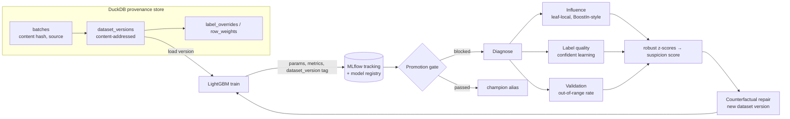

# BatchSleuth

**Counterfactual training-data debugging for ML systems.** When a retrained model gets worse,
BatchSleuth traces the regression to the training-data *batches* that caused it, tests repairs
counterfactually (drop / relabel / reweight → retrain), and only promotes a model that passes
safeguards.

[](https://github.com/aditib03/batchsleuth/actions/workflows/ci.yml)

`Python` · `LightGBM` · `DuckDB` · `MLflow` · `FastAPI`

<!-- RESULTS -->

---

## Why

Production models are retrained on a stream of data drops: daily files, new sources, re-labelled
exports. When a refresh regresses, the usual question is *"which data did this?"*, and the usual
answer is days of manual bisecting. BatchSleuth automates the loop:

```
new batches ──► retrain ──► regression check ──► diagnose ──► counterfactual repair ──► gated promotion
                                (gate)        (which batches?)   (what if we fix them?)    (is it safe?)
```

## Quickstart

```bash
git clone https://github.com/aditib03/batchsleuth.git && cd batchsleuth
make setup        # venv + editable install; nothing installed system-wide
make demo         # ~40 s: ingest -> regression -> diagnose -> repair -> promote
make serve        # API + interactive docs at http://127.0.0.1:8000/docs
make test         # 18 tests, ~35 s, synthetic data only
make bench-quick  # ~2.5 min smoke benchmark;  `make bench` for the full ~30 min run
```

The demo downloads the UCI Covertype dataset once (~11 MB) through scikit-learn.

### What the demo shows

80 historical batches train the champion. 20 new daily batches arrive, and 5 of them carry pipeline
bugs (a zero-filled outage, a broken join, a positive→negative labelling bug, a unit change from a
new source, random label noise). The refreshed model is **blocked** by the promotion gate, then:

```
$ batchsleuth diagnose <candidate-run>
batch  score  z_influence  z_label_quality  z_validation  explanation
38     85.1   4.4          -0.9             80.7          raises eval loss; 42% rows out of range (e.g. elevation); ...
69     81.7   5.1          -0.3             76.6          raises eval loss; 40% rows out of range (e.g. elevation); ...
78     74.1   43.6         29.7             0.7           raises eval loss (influence z=43.6); 26% likely label errors
63     39.9   26.5         12.9             0.4           raises eval loss (influence z=26.5); 14% likely label errors
41     21.5   12.9         8.6              -0.3          raises eval loss (influence z=12.9); 11% likely label errors
13     4.7    2.5          2.2              -0.8          no strong signal
Suspects above threshold: [38, 69, 78, 63, 41]      <- exactly the 5 injected faults

$ batchsleuth repair <candidate-run> --action relabel   -> PROMOTION BLOCKED (relabelling can't fix corrupted features)
$ batchsleuth repair <candidate-run> --action drop      -> PROMOTION ALLOWED -> promoted to champion
```

## How it works



**1. Versioned provenance (DuckDB).** Each ingested batch stores a SHA-256 of its contents and its
source. A *dataset version* is a set of batch ids plus an optional repair (label overrides, row
weights), with a content-addressed id: the same inputs always give the same `v-…` id, and every MLflow
run is tagged with the version it was trained on. `GET /batches/{id}` re-hashes the stored rows to
verify integrity and lists every version that used the batch.

**2. Influence approximation for gradient-boosted trees.** Classic influence functions need a
differentiable model; LightGBM isn't one. Following the leaf-based view of BoostIn (Brophy et al.,
JMLR 2023), each tree's leaf value is `v = -lr·G/(H+λ)` over the gradients/hessians of the rows in
that leaf. Up-weighting training row *i* changes it by `∂v/∂εᵢ = -(lr·gᵢ + hᵢ·v)/(H+λ)`, and the
change in evaluation loss is the evaluation-gradient mass in the same leaf times that, summed over
trees. The implementation replays the boosting trajectory and **reproduces LightGBM's own leaf values
to within 1e-8** (it's a unit test). Cost is O((n_train + n_eval)·n_trees): 1.2 s for 200k rows × 150
trees. Batch score = sum of row influences.

**3. Label quality (confident learning).** 3-fold out-of-fold LightGBM probabilities; a row is a
likely label error when the model confidently predicts the other class (above that class's mean
self-confidence). Batch score = fraction of flagged rows.

**4. Data validation.** Fraction of rows with any numeric feature outside the trusted reference's
[0.1%, 99.9%] range. It catches zero-fills, sentinels and unit changes that label-centric signals miss.
PSI drift is computed for explanations but **deliberately excluded from the score** (see findings).

**5. Combination.** Each signal is turned into a robust z-score across batches
(median/MAD); the suspicion score is the sum of positive z's. Batches with score ≥ 6 (capped at 10% of
batches) become repair suspects. Weights and the threshold were chosen on tuning seeds 100–101, which
the benchmark never uses.

**6. Counterfactual repair.** `drop` excludes suspect batches; `relabel` flips confident-learning
issues inside suspects only; `reweight` down-weights suspect rows by out-of-fold label confidence.
Each repair is a new dataset version (with lineage to its parent) and a new MLflow run.

**7. Promotion safeguards.** A candidate replaces the champion only if all checks pass on a
holdout slice that diagnosis never sees: AUC non-inferiority (paired bootstrap 95% CI), log-loss,
calibration (ECE), worst per-slice AUC, and a cap on how much training data a repair may remove.

## Benchmark methodology

`benchmark/run.py` is fully reproducible (`make bench`):

* **Data:** UCI Covertype as binary "Lodgepole Pine vs rest", 100 batches × 2,000 rows + 30k holdout
  (5k for diagnosis, 25k for the gate). Batches are deliberately **non-i.i.d.**: rows are ordered by a noisy
  geographic key, so clean batches differ from each other like real sources do. With i.i.d. batches, every
  method (even a naive loss ranking) scored 100%, which tells you nothing.
* **Faults** (`batchsleuth/faults.py`): random label flips, positive→negative class flips, broken-join
  column shuffles, unit change + label-policy shift, zero-fill outages. **Severity = fraction of the bad
  batch's rows affected** (5% / 15% / 40%), so most rows in a bad batch look normal.
* **Grid:** 5 faults × 3 severities × k ∈ {1, 3, 5} corrupted batches × 3 seeds = 135 scenarios.
* **Metrics:** precision@k and average precision for localization; recovery = share of the log-loss
  regression undone by the repair (vs an oracle that drops exactly the bad batches); gate block rate
  on corrupted candidates and false-block rate on clean controls; wall-clock overhead vs exact
  leave-one-batch-out (LOBO) retraining.
* **Baselines:** each signal alone, PSI drift, mean training loss per batch, random.

## Limitations & honest findings

<!-- FINDINGS -->

## API

| method | path | purpose |
|---|---|---|
| GET | `/health`, `/status` | liveness; runs, versions, champion |
| GET | `/batches`, `/batches/{id}` | provenance; re-verifies the content hash |
| GET | `/versions`, `/versions/{id}` | dataset versions and lineage |
| GET | `/runs/{run_id}/check` | regression check / promotion gate vs champion |
| POST | `/diagnose` | ranked suspect batches with explanations |
| POST | `/repair` | counterfactual dataset version → retrain → gate |
| POST | `/promote` | promote only if the gate passes |

`BATCHSLEUTH_READ_ONLY=1` disables `/repair` and `/promote` and caches results (used for the public demo).

## Resource footprint

Measured on an Apple M4 laptop: peak RAM ≈ 1.2 GB; full training run 0.4 s; full diagnosis ≈ 2.3 s;
disk ≈ 25 MB of data + MLflow state (plus ~800 MB virtualenv). LightGBM is capped at 4 threads by
default (`BATCHSLEUTH_N_JOBS`), and benchmarks run under `nice`. No GPU or cloud compute needed.

On macOS, LightGBM needs an OpenMP runtime. If Homebrew's `libomp` is missing, `make setup` points
LightGBM at the copy bundled inside scikit-learn's wheel (only files inside `.venv` are touched);
`brew install libomp` also works.

## Deploying the public demo

The `Dockerfile` builds the demo at image-build time and serves the API read-only on port 7860. It
works as-is on a **Hugging Face Space** (SDK: Docker) or Render/Fly.io:

```bash
docker build -t batchsleuth . && docker run -p 7860:7860 batchsleuth   # http://localhost:7860/docs
```

## Layout

```
batchsleuth/   data, faults, provenance (DuckDB), model, influence, labelq, drift,
               diagnose, repair, gate, tracking (MLflow), pipeline, api (FastAPI), cli
benchmark/     run.py + results/ (CSV, summary.json, results.md, figures)
tests/         unit + end-to-end API tests (synthetic data)
```

## References

* Brophy, Hammoudeh & Lowd. *Adapting and Evaluating Influence-Estimation Methods for Gradient-Boosted Decision Trees.* JMLR 2023.
* Koh & Liang. *Understanding Black-box Predictions via Influence Functions.* ICML 2017.
* Northcutt, Jiang & Chuang. *Confident Learning: Estimating Uncertainty in Dataset Labels.* JAIR 2021.
* Pruthi et al. *Estimating Training Data Influence by Tracing Gradient Descent (TracIn).* NeurIPS 2020.

MIT licensed.
