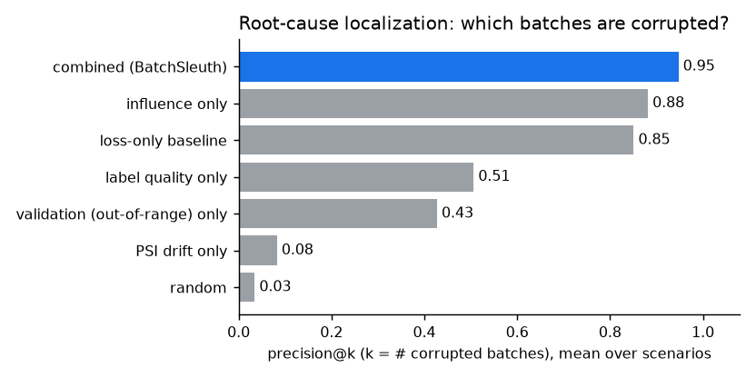
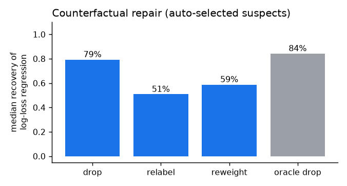
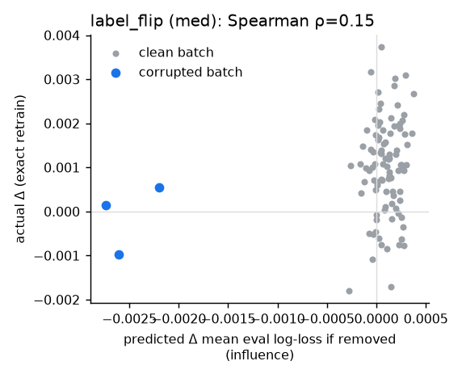

# Benchmark results

135 fault-injection scenarios on UCI Covertype (100 batches x 2,000 rows), 85 of which produced a measurable regression (log-loss gap >= 0.001). Wall clock 37.7 min on arm64 / Darwin with 4 LightGBM threads. Reproduce with `make bench`.

## Root-cause localization

| method | precision@k | average precision |
|---|---|---|
| combined (BatchSleuth) | 0.947 | 0.960 |
| influence only | 0.881 | 0.905 |
| loss-only baseline | 0.851 | 0.876 |
| label quality only | 0.506 | 0.559 |
| validation (out-of-range) only | 0.427 | 0.458 |
| PSI drift only | 0.082 | 0.147 |
| random | 0.035 | 0.074 |

### precision@k by fault type

| fault | combined (BatchSleuth) | influence only | label quality only | validation (out-of-range) only | PSI drift only | loss-only baseline | random |
|---|---|---|---|---|---|---|---|
| class_flip | 0.91 | 0.94 | 0.79 | 0.04 | 0.03 | 0.91 | 0.03 |
| feature_shuffle | 0.82 | 0.84 | 0.66 | 0.07 | 0.00 | 0.84 | 0.01 |
| label_flip | 1.00 | 1.00 | 0.94 | 0.02 | 0.01 | 0.99 | 0.06 |
| missing_burst | 1.00 | 0.70 | 0.04 | 1.00 | 0.21 | 0.72 | 0.03 |
| unit_change | 1.00 | 0.93 | 0.12 | 1.00 | 0.16 | 0.80 | 0.04 |

## Counterfactual repair (regressed scenarios)

Auto-selected suspects: precision 0.99, recall 0.91, 2.7 batches flagged on average.

| repair | median recovery | mean recovery (clipped) |
|---|---|---|
| drop | 79% | 77% |
| relabel | 51% | 38% |
| reweight | 59% | 55% |
| oracle drop | 84% | 81% |

## Promotion gate

- Blocks 38% of all corrupted candidates and 100% of those with log-loss regression >= 0.004 (n=14).
- Passes 89% of drop-repaired candidates.
- False-block rate on clean control candidates: 7% (n=15).

## Overhead

- Full diagnosis (influence + 3-fold label quality + validation): 2.7s; influence alone 1.47s; one full training run 0.47s.
- Exact leave-one-batch-out (100 retrains): 63s -> influence is 44x faster, full diagnosis 24x.

## Influence approximation vs exact leave-one-batch-out

Over 10 scenarios: Spearman 0.06, Pearson 0.11 between predicted and actual change in evaluation loss. precision@k: exact LOBO 0.13, influence 0.87, combined 1.00.

Why the low correlation: removing one corrupted batch changes mean eval log-loss by only -0.00054, versus a spread of 0.00107 across clean-batch removals (signal-to-noise 0.5); single GBDT retrains are dominated by tree-structure changes. The influence score separates corrupted batches with signal-to-noise 14.3, and agrees with LOBO on the sign of the effect for 53% of corrupted batches. The group counterfactual (dropping all suspects, see recovery) is the more reliable check.

